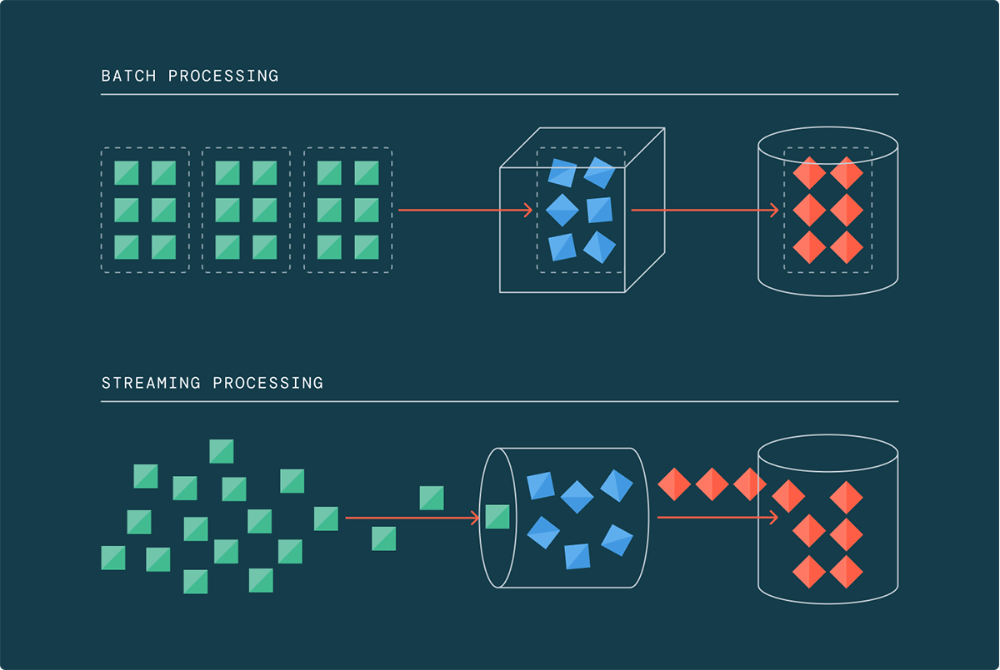
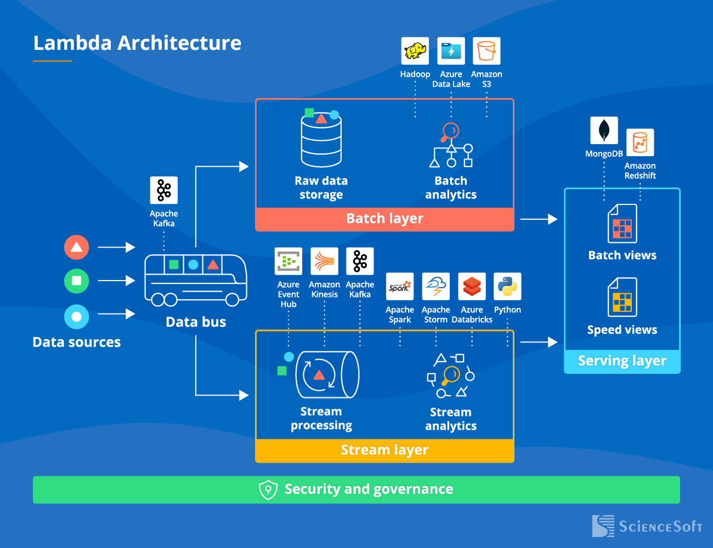
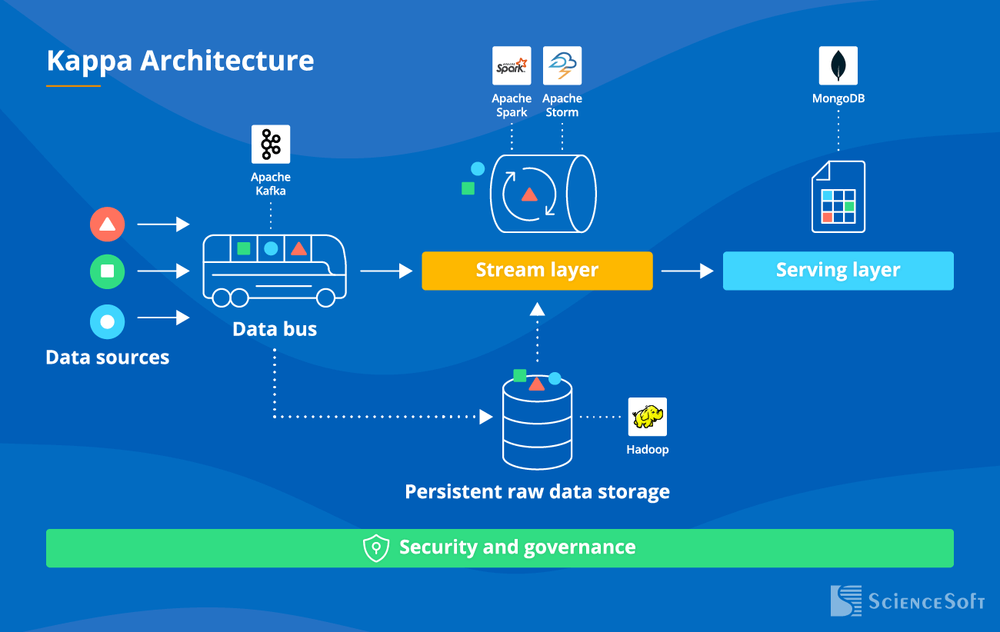
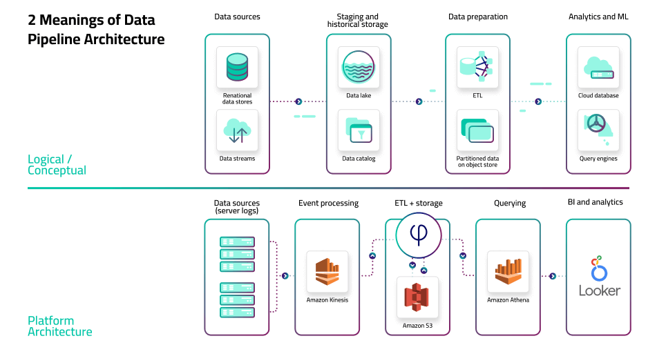

## UD1 — Arquitecturas Big Data

Elegir con criterio: latencia, coste y calidad

---

## Una arquitectura es una cadena de decisiones

```text
fuentes → ingesta → almacenamiento → procesamiento → consulta → consumo
```

- ¿Qué entra y a qué ritmo?
- ¿Dónde se conserva y cómo se transforma?
- ¿Qué calidad, latencia y coste podemos prometer?

> No es un dibujo: es una decisión técnica justificable.

---

## Primera pregunta: ¿cuándo necesito el dato?



| Necesidad | Candidato | Coste principal |
|---|---|---|
| Informe estable, D+1 | **Batch** | Esperar al lote |
| Alerta en segundos | **Streaming** | Complejidad operativa |

**Regla práctica:** si batch resuelve el problema, no fuerces streaming.

---

## Batch: histórico, sencillo y trazable

```text
fuentes del día → lote → transformación → resultado estable
```

- Ventana con inicio y fin.
- Más fácil de depurar y normalmente más barato.
- Ideal para ventas diarias, reservas nocturnas y entrenamiento periódico.

**No encaja** cuando la decisión caduca en segundos o minutos.

---

## Streaming y eventos: reaccionar sin acoplar

```text
app / sensor ──evento──► broker o log ──► consumidores independientes
                                             ├─ alertas
                                             ├─ dashboard
                                             └─ almacenamiento
```

- Flujo continuo y baja latencia.
- El evento puede reprocesarse y auditarse.
- Hay que resolver duplicados, eventos tardíos y ventanas temporales.

---

## Lambda: precisión + actualidad



**Dos caminos, una vista de consumo:**

- **Batch:** histórico completo y resultado preciso.
- **Streaming:** señal reciente y baja latencia.
- **Serving:** une resultados para consultar.

⚠️ Potente, pero duplica lógica, coste y posibilidades de inconsistencia.

---

## Kappa: un único flujo de eventos



```text
fuentes → log de eventos → procesamiento streaming → vistas
                         ↘ reprocesar histórico
```

- Conviene cuando todo puede expresarse como eventos.
- Reprocesar es volver a leer el log.
- Puede quedarse corta ante históricos muy pesados o lógicas muy distintas.

---

## Lambda o Kappa: la pregunta que decide

| Si necesitas… | Elige… |
|---|---|
| Histórico preciso **y** señal reciente | **Lambda** |
| Un mismo tratamiento para pasado y presente | **Kappa** |
| Informe diario sin urgencia | **Batch** |
| Alertas operativas | **Streaming / Kappa** |

La arquitectura correcta es la que reduce riesgo, no la que suena más moderna.

---

## Arquitectura por capas: cada pieza tiene un trabajo



```text
ingesta → transporte → procesamiento → almacenamiento → consulta → visualización
```

Las capas desacoplan responsabilidades: podemos cambiar una herramienta sin rehacer todo el sistema.

---

## Medallion: mejorar la calidad por etapas

```text
fuentes → BRONZE → SILVER → GOLD → consumo
          crudo      limpio    negocio
```

- **Bronze:** conserva lo recibido y permite reprocesar.
- **Silver:** valida, deduplica, tipa, limpia y enriquece.
- **Gold:** publica KPIs, vistas y datasets listos para consumir.

Medallion puede convivir con batch **o** streaming.

---

## Calidad y trazabilidad: poder explicar el KPI

| Capa | Pregunta |
|---|---|
| Bronze | ¿Puedo reconstruir el original? |
| Silver | ¿Está limpio y unido correctamente? |
| Gold | ¿Responde a una pregunta con rendimiento aceptable? |

Conserva siempre: **fuente · fecha de carga · versión · reglas · rechazados · esquema · responsable**.

> Si no sabemos de dónde sale un KPI, el dashboard no es fiable.

---

## Caso: turismo + ventas

```text
CSV ventas     API reservas     JSON web     meteo
      \             |              /          /
       └────────── BRONZE ────────┘
                    ↓
          SILVER: fechas, unidades, joins
                    ↓
          GOLD: KPIs por ciudad y ocupación
```

- Dashboard diario → **batch + Medallion**.
- Pico de ventas o alerta → añadir **streaming**.
- DuckDB + Parquet en aula; Spark si el volumen lo justifica.

---

## Elegir sin caer en la moda

1. Define el caso de uso y su latencia.
2. Lista fuentes, volumen y frecuencia.
3. Decide qué debe ser raw, limpio y consumible.
4. Justifica herramienta, coste y mantenimiento.

**Arquitectura docente razonable:**
`CSV/JSON → Bronze Parquet → Silver DuckDB/Python → Gold → dashboard`

---

## Actividad de cierre

Elige: **KPIs turísticos diarios**, **alerta de ventas** o **reservas + meteorología**.

En 5 minutos, justifica:

- [ ] ¿Batch, streaming, Lambda, Kappa o combinación?
- [ ] ¿Qué entra en Bronze?
- [ ] ¿Qué reglas aplicas en Silver?
- [ ] ¿Qué publicas en Gold?
- [ ] ¿Qué coste o limitación aceptas?

**Salida:** un diagrama de 4–6 cajas y una decisión defendida.
